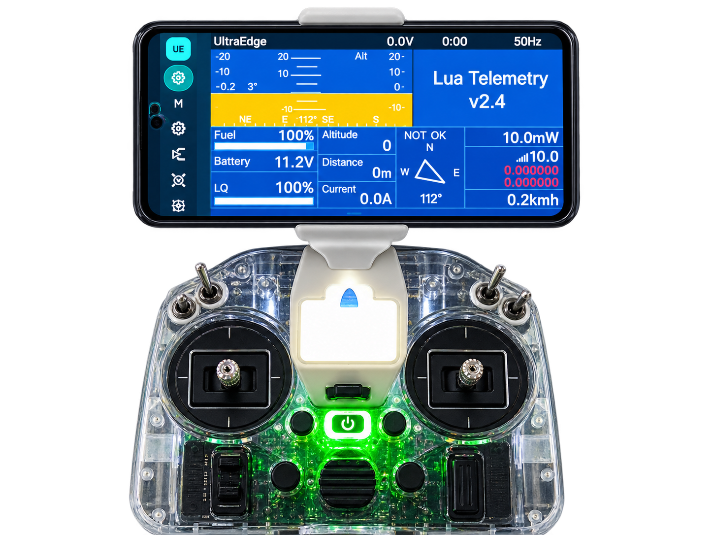

# UltraEdge mounts

3D-printable parts that hold a phone on your radio, so you can use the [UltraEdge app](https://github.com/50UR4V/UltraEdge-app)
at the field. Get the app on [Google Play](https://play.google.com/store/apps/details?id=com.ultraedge.companion).

## Parts

| Part | What it is | Size (mm) |
|---|---|---|
| Unimount AB Unified | The phone clamp: both halves in one file, printed in place. Stronger rubber-band hooks. **Start here.** | 35 × 73 × 24 |
| Pocket Bracket USB | Holds the clamp on a RadioMaster Pocket, with a gap for the USB-C cable. | 49 × 69 × 30 |
| QX7 Bracket | Holds the clamp on a FrSky Taranis QX7. | 16 × 49 × 14 |
| TX16S Bracket | Holds the clamp on a RadioMaster TX16S MKII. | 16 × 22 × 14 |
| Unimount A, Unimount B | The earlier clamp as two separate files, with the original hooks. Use the unified file instead. | 35 × 57 × 21, 35 × 65 × 21 |

Print the unified Unimount, plus the bracket for your radio.

## Printing

| Setting | Value |
|---|---|
| Material | PLA+ |
| Layer height | 0.2 mm |
| Walls | 4 |
| Infill | 40 %, cubic |
| Supports | Only where your slicer flags overhangs |

The Unimount prints in place as two parts. After printing, check that the two parts slide freely.

## Assembly

1. Fit rubber bands over the hooks of the Unimount. They are the springs that close the clamp on the phone.
2. Glue the Unimount to the bracket for your radio.
3. TX16S and QX7: fix the bracket to the radio's lanyard hole with an M3 screw (about 15 mm) and an M3 nut.

## Hardware

- Rubber bands
- Glue
- TX16S and QX7: one M3 × 15 mm screw (approximately) and one M3 nut

## Files

- `3mf/` — the designs as exported from Onshape. Use these if your slicer reads 3MF.
- `stl/` — the same parts as STL, in millimetres, for slicers and sites that want STL.
  Made from the 3MF files with `tools/3mf2stl.py`.

Found a fit problem or made a bracket for another radio? Open an issue or a pull request.

## UltraEdge Wireless module shells

[`wireless-module/`](wireless-module/) holds the printable shells for the UltraEdge Wireless bay module (prototype): a 2-in-1 for JR and nano bays, and one for the Pocket.

## Licence

- The phone mounts (`3mf/`, `stl/`): [CC BY-NC-SA 4.0](LICENSE). You may print, change and share these parts with
  credit, but not sell them or prints of them, and changed versions must use the same licence.
- The wireless module shells (`wireless-module/`): [CC BY-SA 4.0](wireless-module/LICENSE). You may also sell them or
  prints of them, with credit; changed versions must use the same licence.

UltraEdge is not affiliated with or endorsed by EdgeTX, FrSky or RadioMaster.
